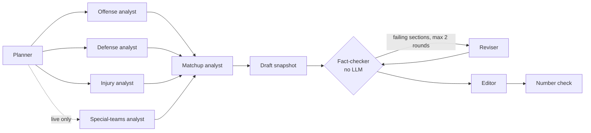

# nfl-scouting-report

**[Live demo](https://nfl-scouting-reporter.streamlit.app/):** browse the weekly reports and hover over any number to see the tool call behind it and its check result.

A multi-agent system that writes NFL opponent scouting reports from nflverse play-by-play data, with an evaluation harness that measures how accurate the reports are. Analyst agents (Claude Haiku 5.5 in LangGraph) draft each section by calling deterministic SQL tools. A fact-checker with no LLM then re-runs every cited tool call before an editor writes the final report.

**Headline result** (360 reports on 40 games from 2026 weeks 4–7, after the model's training cutoff): the fact-checker raises final claim accuracy from **99.5% to 100.0%** and cuts report numbers with no supporting claim from **0.3% to 0.1%**. It costs **$0.031 per report**, against $0.021 without it. Draft accuracy is about 99% in every configuration, so the checker fixes the remaining errors rather than rescuing poor drafts. Full tables are in [docs/results.md](docs/results.md).

## How it works



- **Tools:** 26 deterministic functions over DuckDB (EPA, success rate, explosives, pass rate over expected, blitz rate, box counts, usage, injuries, snap shares, league ranks, and special teams). Every tool takes `through_week` and never reads later games. A test runs every tool against future-week rows to enforce this.
- **The LLM writes every number.** Each number in the prose has a marker (`61.2% [oc3]`) that points to a claim. The claim cites one tool call, or says how it was derived from other claims. Tool outputs only appear in the trace, never in the prose, so accuracy can be measured.
- **Fact-checker:** re-runs each cited call and compares the stated value at the precision written. It checks that the claim's wording matches the call's arguments (team, side, play type, down, split, player, weeks), and that every number in the prose has a claim. Failing sections go back to their analyst for revision. Claims that still fail after two rounds are dropped.
- **Editor:** merges the sections into one report, keeps every marker with its own number, and is asked once to shorten a report that runs long. A final number check links every number in the report to a claim.

## Evaluation

| | Full graph | No fact-checker | Single agent |
|---|---|---|---|
| Final claim accuracy | **100.0%** | 99.5% | 99.5% |
| Report numbers with no claim | 0.1% | 0.3% | 1.5% |
| Numbers per report | 65.9 | 69.0 | 47.2 |
| Cost per report | $0.031 | $0.021 | $0.014 |

The single agent gets every tool (exactly the API's 20-strict-tool limit), but its reports have about 30% fewer numbers.

How the numbers are kept honest:
- **Clean test set.** The test games are from the 2026 season, after every model's June 2026 training cutoff. The set is 40 games, one report per game, 3 repeats per configuration, frozen in `eval/matchups_v1.json`.
- **Generate once, score many times.** Runs are saved, and scoring reads only the saved files against a frozen, hashed data snapshot. Scoring never calls the API.
- **Drafts are scored too.** A snapshot taken before the fact-checker shows what the checker changed.
- **Independent re-derivation.** About 2,840 claims were recomputed with separate polars code. The tools agreed 100%.
- **Planted errors.** Wrong values, teams and splits, plus unlinked numbers, were injected into clean drafts. The checker catches 99.9–100% of them, with at most 1 false positive per configuration. Its known blind spots are sign errors and claims that name both the right team and a wrong one.
- **Forward check.** Do season-to-date numbers predict the next game better than the league average? Mostly not: they're closer on only 46–48% of claims in every configuration, because 3–6 games of data regress to the mean. This is a finding about early-season data, not about the agents.
- **Hand grading.** 30 reports (10 games × 3 configurations) were graded blind (1–5) for relevance, reasoning, actionability and coverage, and ranked:

  | | Full graph | No fact-checker | Single agent |
  |---|---|---|---|
  | Average grade | 4.1 | 3.8 | 3.4 |
  | Ranked first | 7 of 10 | 3 of 10 | 0 of 10 |

  The full graph beats the single agent clearly: +0.72, interval +0.33 to +1.10. Its lead over the no-checker graph is suggestive but not conclusive with 10 games: +0.35, interval −0.05 to +0.68. The grader also caught two errors no number check can see: titles with the venue backwards (now fixed: every node is told the home team) and one single-agent report written from the wrong team's point of view.

**Live reports.** Week 10 produced 14 reports, one per game from the home team's view, for $0.51, with 874 of 875 report numbers checked. From week 11, every team gets a report on its opponent, and each report adds a special-teams section: field goals by distance and kicker changes, punting, kickoffs, returns and special-teams EPA.

## Limitations

- **Early season only.** The test games give each report 3–6 weeks of data. Later in the season samples are larger and reports longer, so the results may differ. The live reports give a partial check on that.
- **Special teams is not in the measured evaluation.** It was added after the evaluation ran, for live reports only. Its numbers go through the same fact-checker.
- **One model.** Haiku 5.5 on every node. No comparison with Sonnet, Opus or a local model (a planned Ollama run was dropped).
- **One grader, 10 games.** Usefulness is graded by one person, blind to the configuration but not independent. The single agent's reports are also shorter, which may affect its coverage grades.
- **The eval's reports were made before the venue and team-name fixes.** About a third of the titles that name a venue have it backwards. One eval report (and one week-11 live report) calls Indianapolis "Indiana". The fact-checker and editor now flag state and former team names. The editor also flags a backwards venue on live reports, and live prompts give both teams' full names. The saved reports were left as generated.
- **Synthetic errors.** Planted errors may be easier to catch than natural ones.
- **Data limits.** There is no personnel, coverage (man/zone), true pressure or route data. "Pressure proxy" means sacks plus QB hits, and it undercounts real pressure. Special-teams samples are small, and the data has no hang time or snap timing.

## Future work

- **Bigger models:** run Sonnet 5.5 (about $6) or Opus 5.5 on the 10 graded games and blind-grade them against Haiku, to see whether a larger model writes more useful reports.
- **Special teams in the measured evaluation,** with seeded errors and independent re-derivation for its tools.
- **Later-season evaluation** (`matchups_v2`, weeks 8+), where samples are larger.
- **A second grader** for inter-rater agreement, and an LLM judge calibrated against the hand grades.
- **Checker blind spots:** sign errors, and claims that name both the right and a wrong team.

## Setup

Requires [uv](https://docs.astral.sh/uv/) and Python 3.12.

```bash
uv sync
cp .env.example .env   # add your ANTHROPIC_API_KEY
uv run pytest
```

## Usage

```bash
uv run python -m nfl_scout.data.ingest                  # download nflverse data into data/nfl.duckdb
uv run python -m nfl_scout.graph.run --team BUF --opponent NYJ --week 10 --graph full_st
uv run python -m nfl_scout.live --week 11               # check data readiness and estimate cost
uv run python -m nfl_scout.live --week 11 --yes         # one report per team
uv run streamlit run app/streamlit_app.py               # demo: hover any number to see its claim
```

Evaluation (spends API credit; prints an estimate first):

```bash
uv run python -m nfl_scout.evaluation.run_eval --config full --repeats 1 2 3
uv run python -m nfl_scout.evaluation.score --mlflow    # offline, reads saved runs only
uv run python -m nfl_scout.evaluation.results           # writes docs/results.md
```

`config/settings.yaml` sets the model and effort for each node. `NFL_SCOUT_MODEL=haiku|sonnet|opus` runs every node on one model.

## Layout

```
app/           Streamlit demo (reads demo/, no API calls)
config/        settings.yaml
src/nfl_scout/ data/ (ingest), tools/ (metric functions), graph/ (LangGraph nodes, prompts),
               checker.py, numbers.py, evaluation/ (matchups, scoring, seeding, forward check, grading)
eval/          frozen matchups, data snapshot record, results notes
docs/          results and data coverage
demo/          saved live reports for the demo
tests/         pytest suite (no API calls)
```
